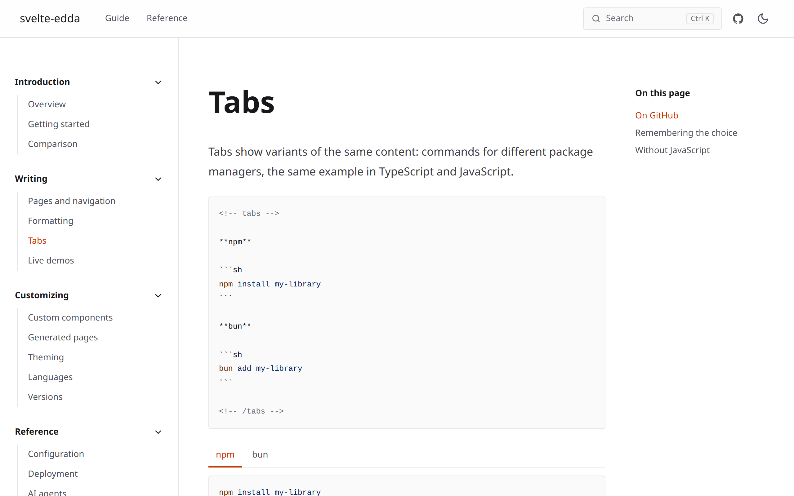

# svelte-edda

[](https://www.npmjs.com/package/svelte-edda)
[](https://github.com/krowten/svelte-edda/actions/workflows/ci.yml)
[](LICENSE)

A static documentation site generator for Markdown. svelte-edda turns a `docs/` folder of plain
Markdown into a fast documentation website with search, live Svelte demos, translations, versioned
docs and `llms.txt` for AI agents. Your project needs neither Svelte nor Vite: it is one CLI.
An alternative to VitePress, Docusaurus and Starlight for docs that stay readable as plain Markdown
on GitHub ([comparison](https://krowten.github.io/svelte-edda/comparison/)).

📖 **[Documentation](https://krowten.github.io/svelte-edda/)** (also readable [on GitHub](./docs/index.md)):
writing pages, tabs, live demos, custom components, theming, deployment.



- **Markdown is the source.** Components are HTML comments around ordinary Markdown, so pages read
  well on GitHub, in your npm package and for AI agents.
- **Svelte components and live demos.** Tabs, cards, steps and a hero are built in. Register your own components; interactive ones hydrate as
  islands. A `svelte live` code block renders as a working component above its source.
- **Tailwind theme.** Override colors and fonts with `@theme` tokens, swap the logo.
- **Languages and versions.** A folder per language with fallback to the default one; older
  releases archived from git tags. Interface strings in MessageFormat 2 (English, Russian, German).
- **Generated pages.** Props tables from your Svelte 5 components, built in, and an API reference
  from TypeDoc or any command, before every build;
  `check` catches a committed reference that went stale. Recipes are in the docs.
- **For agents.** Every page is also served as `.md`, plus `llms.txt` and `llms-full.txt`. A
  strict checker and a generated writing guide keep agents that edit the docs on the syntax.
- **Static output** with search (Pagefind), a sitemap, `robots.txt`, social cards, canonical URLs,
  `hreflang` and structured data. Deploys to GitHub Pages, Netlify, Cloudflare Pages or any static
  host.

```sh
bun add -d svelte-edda
bunx svelte-edda dev
```

A component is a pair of HTML comments around ordinary Markdown, so the page still reads well
where nothing renders it:

````md
<!-- tabs -->

**npm**

```sh
npm install my-library
```

**bun**

```sh
bun add my-library
```

<!-- /tabs -->
````

`svelte-edda guide` prints the syntax and the components of your project, and
`svelte-edda check` reports wrong markers, broken links and syntax borrowed from other tools.
Point your coding agent at both.

## The name

The Eddas are the Old Norse books of poems and lore, from the world that wrote in runes. Svelte 5
has runes too; this is where you write down the lore.

## Contributing

```sh
bun install
bun run dev          # this repository's docs on the dev server
bun run lint
bun run check
bun test
bun run smoke:pack   # installs the packed tarball into throwaway projects
```

See [CONTRIBUTING.md](CONTRIBUTING.md).

## License

MIT © Vladimir Kraikovskii
